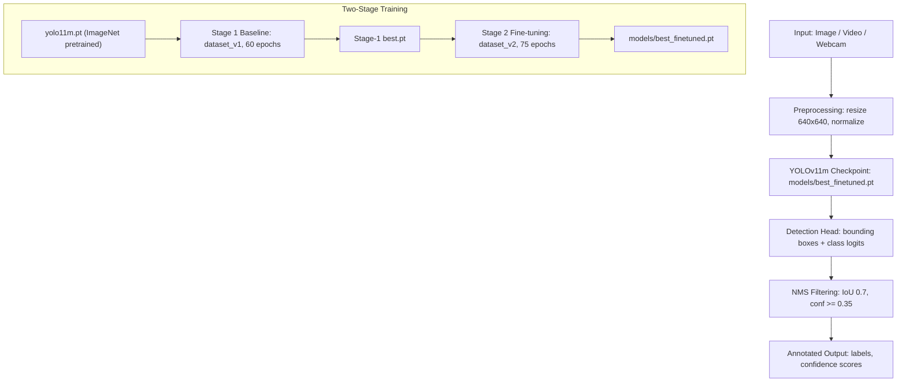
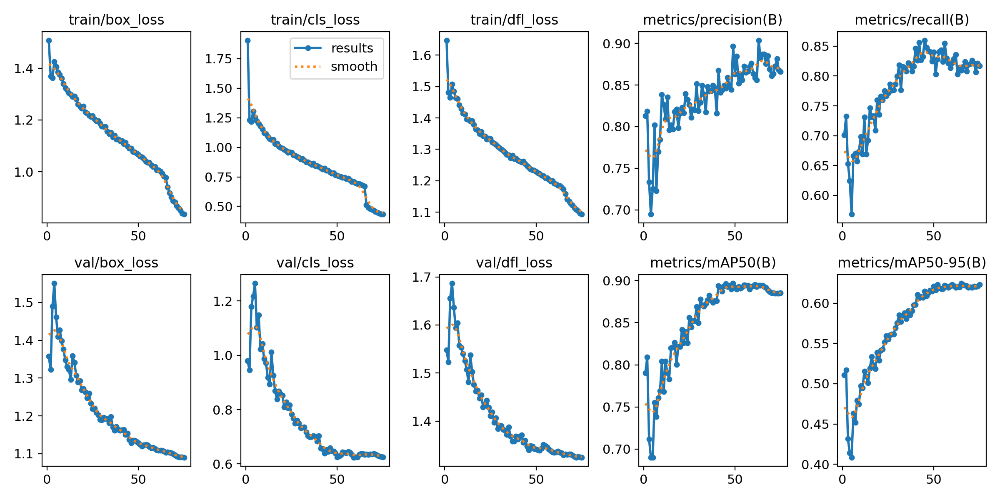
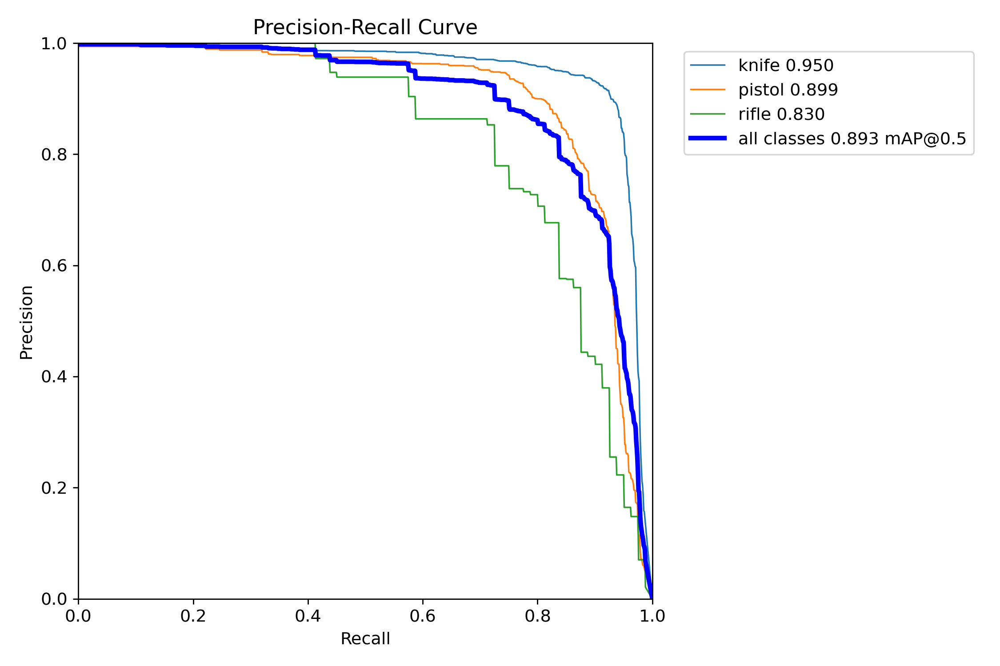
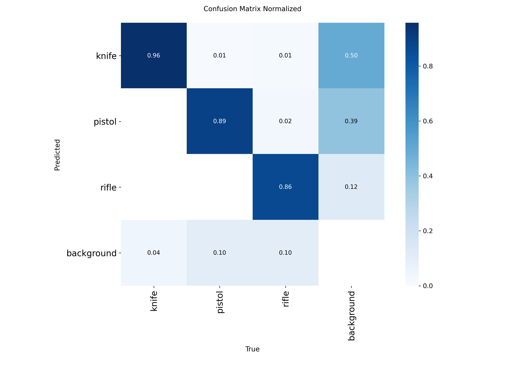
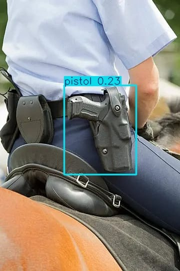

# YOLOv11 Weapon Detection System

<p align="center">
  
  
  
  
  
  
</p>

<p align="center">
  <strong>
    A two-stage fine-tuned YOLOv11 object detector that localises knives, pistols, and rifles
    in images and video using a merged multi-source dataset of ~15,000 annotated images.
  </strong>
</p>

---

## Table of Contents

1. [Overview](#overview)
2. [Problem Statement](#problem-statement)
3. [Detected Classes](#detected-classes)
4. [Features](#features)
5. [System Workflow](#system-workflow)
6. [Dataset](#dataset)
7. [Model and Training](#model-and-training)
8. [Evaluation Results](#evaluation-results)
9. [Repository Structure](#repository-structure)
10. [Installation](#installation)
11. [Model Weights](#model-weights)
12. [Inference](#inference)
13. [Results and Samples](#results-and-samples)
14. [Android Application](#android-application)
15. [Dataset Preparation Scripts](#dataset-preparation-scripts)
16. [Technologies](#technologies)
17. [Limitations](#limitations)
18. [Future Work](#future-work)
19. [Responsible Use](#responsible-use)
20. [License](#license)
21. [Author](#author)

---

## Overview

This project investigates whether a lightweight YOLO-family object detector can reliably localise
three categories of weapons — knives, pistols, and rifles — in still images and video frames.

Starting from the official `yolo11m.pt` pretrained checkpoint, the model was trained in **two stages**:

| Stage | Script | Dataset | Epochs | Starting weights |
|-------|--------|---------|--------|-----------------|
| 1 — Baseline | `src/train_v1.py` | `dataset_v1` (~14,000 images) | 60 | `yolo11m.pt` (ImageNet pretrained) |
| 2 — Fine-tuning | `src/train_v2.py` | `dataset_v2` (~15,800 images) | 75 | Stage-1 `best.pt` |

The fine-tuned model (`models/best_finetuned.pt`) achieved **mAP@50 = 89.7%** on the validation split.

> **Note:** This is a research and portfolio project. The model is not production-validated.
> See [Responsible Use](#responsible-use) and [Limitations](#limitations).

---

## Problem Statement

Manual review of large image or video feeds for weapon presence is slow and error-prone.
This project explores deep-learning object detection as an **assistant tool** that can flag
frames of interest for human review — not replace it.

---

## Detected Classes

Verified against `config/data_v1.yaml` and `config/data_v2.yaml`:

| Class ID | Class Name |
|:--------:|-----------|
| 0 | knife |
| 1 | pistol |
| 2 | rifle |

---

## Features

The following features are **implemented and verified** in the current codebase:

- **YOLOv11m-based object detection** — bounding boxes, class labels, confidence scores
- **Image inference** — single image or folder (`src/infer.py`)
- **Video-file inference** — frame-by-frame detection with annotated output video
- **Live-webcam inference** — real-time detection via `--source 0`
- **Offline Android application** — real-time CameraX detection using bundled FP16 TFLite model (`android/`)
- **Configurable confidence threshold** — `--conf` flag (default 0.35)
- **Saving annotated results** — enabled by default, disable with `--no-save`
- **Two-stage training pipeline** — reproducible via `src/train_v1.py` and `src/train_v2.py`
- **ONNX and TFLite exports** — checkpoints exported for edge and mobile deployment
- **Ensemble/WBF inference** — `src/combo.py` combines two model checkpoints via Weighted Boxes Fusion
- **Dataset preparation scripts** — merging and train/val/test splitting utilities in `src/`

---

## System Workflow



---

## Dataset

### Sources

The training data was merged from **three public datasets** using `src/merge_datasets.py`:

| Source | Type | Weapon classes used |
|--------|------|---------------------|
| Kaggle weapon-detection archive | Flat images + YOLO labels | pistol, knife |
| Kaggle YOLOv3 weapon dataset | Flat images + YOLO labels | knife, pistol, rifle |
| Roboflow Rifle OBB dataset (converted) | YOLOv5-OBB converted to YOLO axis-aligned | rifle |

### Dataset Versions

| Version | Train | Val | Test | Total | Used in |
|---------|------:|----:|-----:|------:|---------|
| `dataset_v1` | 11,342 | 2,126 | 710 | **14,178** | Stage-1 baseline training |
| `dataset_v2` | 13,005 | 1,923 | 884 | **15,812** | Stage-2 fine-tuning |

*Image counts verified from local directory listings.*

### Annotation Format

All annotations are in **YOLO format** (normalised centre-x, centre-y, width, height per line).
OBB-format rifle annotations were converted to axis-aligned bounding boxes using `src/convert.py`.

### Dataset Access

The datasets are **not included in this repository** due to size (~255 MB compressed) and
redistribution considerations. Original sources:

- [Kaggle: Weapon Detection Datasets](https://www.kaggle.com/datasets/search?q=weapon+detection)
- [Roboflow Universe](https://universe.roboflow.com/)

To reassemble the unified dataset, edit source paths in `src/merge_datasets.py`, then run:

```bash
python src/merge_datasets.py   # merges all sources into Final_Unified_Dataset/
python src/split_images.py     # splits 80/15/5 into train/val/test
```

---

## Model and Training

### Architecture

| Property | Value |
|----------|-------|
| Model family | Ultralytics YOLO |
| Model variant | **YOLOv11m** (medium) |
| Input resolution | 640 x 640 |
| Output | Bounding boxes + class probabilities |

> **Note on repository name:** The `n` in the repository name reflects an earlier working title.
> The `args.yaml` from both training runs confirms `yolo11m.pt` (medium variant) was used.

### Training Configuration

| Hyperparameter | Stage 1 (Baseline) | Stage 2 (Fine-tuning) |
|----------------|-------------------:|----------------------:|
| Starting weights | `yolo11m.pt` | Stage-1 `best.pt` |
| Dataset | `dataset_v1` | `dataset_v2` |
| Epochs | 60 | 75 |
| Batch size | 32 | 32 |
| Image size | 640 | 640 |
| Optimizer | Auto (AdamW) | Auto (AdamW) |
| Initial LR | 0.01 | 0.01 |
| Weight decay | 0.0005 | 0.0005 |
| Early stopping patience | 40 | 40 |
| Augmentation | Enabled (randaugment + mosaic) | Enabled (randaugment + mosaic) |
| Hardware | GPU — Kaggle (CUDA) | GPU — Kaggle (CUDA) |

*Source: `args.yaml` files recovered from each training run.*

### Reproducible Training Commands

```bash
# Stage 1 — Baseline training (from repo root)
python src/train_v1.py --data config/data_v1.yaml --epochs 60 --batch 32 --device 0

# Stage 2 — Fine-tuning (requires Stage-1 best.pt)
python src/train_v2.py \
    --checkpoint runs/baseline_train/detect/train/weights/best.pt \
    --data config/data_v2.yaml \
    --epochs 75 --batch 32 --device 0
```

---

## Evaluation Results

Metrics are from the **Stage-2 fine-tuning validation run** at the best checkpoint (epoch 49 of 75),
evaluated on the `val` split of `dataset_v2`.

### Overall Metrics

| Metric | Value |
|--------|------:|
| **Precision** | **89.6%** |
| **Recall** | **82.5%** |
| **mAP@50** | **89.7%** |
| **mAP@50-95** | **61.5%** |

> These are validation-split metrics from the same distribution as training data.
> No independent test-set evaluation has been performed.

### Per-Class Confusion Matrix (Normalised)

| True \ Predicted | knife | pistol | rifle | background (FN) |
|------------------|------:|-------:|------:|:---------------:|
| **knife** | 0.96 | 0.01 | 0.01 | 0.50 |
| **pistol** | — | 0.89 | 0.02 | 0.39 |
| **rifle** | — | — | 0.86 | 0.12 |

*Strong diagonal dominance. The "background" column represents missed detections (false negatives).*

### Training Curves



### Precision-Recall Curve



### Confusion Matrix (Normalised)



---

## Repository Structure

```text
weapon-detection-yolov11n/
|
+-- assets/                          # Static assets committed to this repository
|   +-- plots/
|   |   +-- training_results.png     # Loss and metric curves (Stage-2 training)
|   |   +-- confusion_matrix_normalized.png
|   |   +-- pr_curve.png
|   +-- inference_samples/
|       +-- sample_knife_detection.jpg
|       +-- sample_pistol_detection.jpg
|       +-- sample_rifle_detection.jpg
|
+-- config/                          # Dataset YAML configurations
|   +-- data_v1.yaml                 # Stage-1 config (14,178 images)
|   +-- data_v2.yaml                 # Stage-2 config (15,812 images)
|
+-- datasets/                        # NOT committed (see Dataset section)
|   +-- dataset_v1/                  # Stage-1 training data
|   +-- dataset_v2/                  # Stage-2 training data (extended)
|
+-- inference_results/               # Sample prediction outputs (committed)
|   +-- baseline/                    # Stage-1 model sample predictions
|   +-- finetune/                    # Stage-2 fine-tuned model sample predictions
|
+-- models/                          # Checkpoints (download separately)
|   +-- best_finetuned.pt            # Best Stage-2 checkpoint (5.2 MB)
|
+-- notebooks/
|   +-- lib.ipynb                    # Kaggle training notebook (both stages)
|   +-- reformat_model.ipynb         # Model export and reformatting
|   +-- labelling.ipynb              # Dataset labelling exploration
|
+-- src/                             # Python source scripts
|   +-- train_v1.py                  # Stage-1 training (portable, CLI args)
|   +-- train_v2.py                  # Stage-2 fine-tuning (portable, CLI args)
|   +-- infer.py                     # Inference: image / video / webcam (portable)
|   +-- combo.py                     # Ensemble WBF inference (two models)
|   +-- merge_datasets.py            # Dataset merging utility
|   +-- split_images.py              # 80/15/5 train/val/test split utility
|   +-- convert.py                   # OBB to axis-aligned YOLO converter
|
+-- android/                         # Android application (Java + TFLite)
|   +-- app/src/main/
|   |   +-- java/com/elandlep/weapondetection/
|   |   |   +-- MainActivity.java         # Home: image/video picker + navigation
|   |   |   +-- LiveDetectionActivity.java  # Real-time CameraX detection
|   |   |   +-- DetectionResultActivity.java # Detection result display
|   |   |   +-- HistoryActivity.java       # Detection history (SQLite)
|   |   |   +-- SettingsActivity.java      # Confidence threshold settings
|   |   |   +-- AboutUsActivity.java       # Team info
|   |   |   +-- YoloDetector.java          # TFLite inference engine + NMS
|   |   +-- assets/
|   |   |   +-- best_float16.tflite        # On-device model (5.1 MB, FP16)
|   |   |   +-- labels.txt                 # Class names: knife, pistol, rifle
|   |   +-- res/layout/                   # Activity layouts
|   |   +-- AndroidManifest.xml
|   +-- build.gradle.kts                  # CameraX + TFLite dependencies
|
+-- .gitignore
+-- CONTRIBUTING.md
+-- requirements.txt
+-- LICENSE
+-- README.md
```

**Excluded from this repository (.gitignore):**
- `datasets/` — large image collections; download from original sources
- `runs/` — full YOLO training run directories; plots copied to `assets/`
- General `*.onnx` and raw weights — core model `models/best_finetuned.pt` and mobile model `best_float16.tflite` are committed
- `*.npy` — calibration data
- `datasets/dataset_v3.zip` — 254 MB archive

---

## Installation

**Requirements:**
- Python 3.11 (tested)
- NVIDIA GPU with CUDA recommended for training; inference runs on CPU

```bash
# 1. Clone the repository
git clone https://github.com/The-lucky-Survivor/weapon-detection-yolov11n.git
cd weapon-detection-yolov11n
```

```bash
# 2. Create and activate a virtual environment
python -m venv .venv

# Windows:
.venv\Scripts\activate

# Linux / macOS:
source .venv/bin/activate
```

```bash
# 3. Install PyTorch — choose ONE based on your hardware

# CPU-only:
pip install torch torchvision --index-url https://download.pytorch.org/whl/cpu

# CUDA 12.1 (recommended for NVIDIA GPU):
pip install torch torchvision --index-url https://download.pytorch.org/whl/cu121
```

```bash
# 4. Install remaining project dependencies
pip install -r requirements.txt
```

---

## Model Weights

The core fine-tuned PyTorch checkpoint (`models/best_finetuned.pt`, 5.2 MB) and the edge mobile model (`android/app/src/main/assets/best_float16.tflite`, 5.1 MB) are **included directly in this repository** and ready to use immediately upon cloning.

Additional exported formats (such as ONNX and full-precision FP32 TFLite) can be exported using the provided notebooks or downloaded from GitHub Releases:

| File | Size | Description | Location / Source |
|------|-----:|-------------|-------------------|
| `best_finetuned.pt` | 5.2 MB | Best Stage-2 fine-tuned PyTorch checkpoint | Bundled in `models/best_finetuned.pt` |
| `best_float16.tflite` | 5.1 MB | Half-precision FP16 mobile model | Bundled in `android/app/src/main/assets/` |
| `best_finetuned.onnx` | 10.2 MB | ONNX export for cross-platform inference | [GitHub Releases](../../releases) / exportable |
| `best_float32.tflite` | 10.1 MB | Full-precision FP32 mobile model | [GitHub Releases](../../releases) |

---

## Inference

Run from the repository root with `models/best_finetuned.pt` present.

### Single Image

```bash
python src/infer.py --source path/to/image.jpg
```

### Folder of Images

```bash
python src/infer.py --source path/to/images/
```

### Video File

```bash
python src/infer.py --source path/to/video.mp4
```

### Live Webcam

```bash
python src/infer.py --source 0
```

### Custom Options

```bash
python src/infer.py \
    --source path/to/image.jpg \
    --conf 0.25 \
    --out inference_results/my_run \
    --show
```

### All Arguments

| Argument | Default | Description |
|----------|---------|-------------|
| `--source` | (required) | Image/folder/video path, or webcam index |
| `--model` | `models/best_finetuned.pt` | Path to `.pt` checkpoint |
| `--conf` | `0.35` | Confidence threshold (0.0-1.0) |
| `--out` | `inference_results/output` | Output directory |
| `--show` | off | Display live in a window |
| `--no-save` | off | Disable saving output |

### Python API

```python
from ultralytics import YOLO

model = YOLO("models/best_finetuned.pt")
results = model.predict(source="image.jpg", conf=0.35, save=True)

for r in results:
    for box in r.boxes:
        print(f"Detected: {r.names[int(box.cls)]}  conf: {float(box.conf):.2f}")
```

### Ensemble Inference (WBF)

`src/combo.py` combines two model checkpoints using Weighted Boxes Fusion.
Edit the path variables at the top of the script, then:

```bash
python src/combo.py
```

Requires `ensemble-boxes` (included in `requirements.txt`).

---

## Results and Samples

**Knife detection**


**Pistol detection**



**Rifle detection**


---

## Android Application

A complete Android application is included in the [`android/`](android/) directory.
It performs **on-device real-time weapon detection** using TensorFlow Lite without any internet connection.

| Feature | Details |
|---|---|
| Language | Java |
| Min SDK | Android 7.0 (API 24) |
| Inference engine | TensorFlow Lite 2.14 + GPU delegate |
| Camera | CameraX 1.2.3 live preview |
| Model bundled | `best_float16.tflite` (5.1 MB, FP16) |
| Full-precision model | `best_float32.tflite` (10.1 MB) — [download from Releases](../../releases) |
| Screens | Live detection, image/video picker, detection history, settings, about |

**To open in Android Studio:** `File → Open → android/`

**To use the full-precision model:** Download `best_float32.tflite` from [Releases](../../releases),
copy it to `android/app/src/main/assets/`, then change `"best_float16.tflite"` → `"best_float32.tflite"`
in `LiveDetectionActivity.java` and `DetectionResultActivity.java`.

---

## Dataset Preparation Scripts

| Script | Purpose |
|--------|---------|
| `src/merge_datasets.py` | Merges three raw source datasets with class remapping |
| `src/split_images.py` | Splits unified dataset 80/15/5 into train/val/test |
| `src/convert.py` | Converts OBB annotations to standard YOLO axis-aligned format |

> These scripts contain absolute paths from the original development environment.
> Edit the configuration variables at the top of each script before use on a new machine.

---

## Technologies

| Technology | Role |
|------------|------|
| [Ultralytics](https://github.com/ultralytics/ultralytics) | YOLO training, inference, and export |
| [PyTorch](https://pytorch.org/) | Deep-learning backend |
| [OpenCV](https://opencv.org/) | Image and video I/O |
| [NumPy](https://numpy.org/) | Numerical computing |
| [ensemble-boxes](https://github.com/ZFTurbo/Weighted-Boxes-Fusion) | Weighted Boxes Fusion |
| [TensorFlow Lite](https://www.tensorflow.org/lite) | On-device mobile inference (Android) |
| [Android CameraX](https://developer.android.com/training/camerax) | Real-time camera feed streaming |
| [Kaggle](https://www.kaggle.com/) | GPU training environment |
| Python 3.11 | Runtime |

---

## Limitations

- Trained and validated on a mixed web-sourced dataset; real-world performance varies significantly
  with image quality, viewpoint, occlusion, and lighting.
- Small or distant objects are harder to detect reliably.
- Confidence scores are not calibrated probabilities.
- The model detects appearance, not intent — it may flag props, toys, or partially visible objects.
- Reported mAP@50 (89.7%) is a validation-split metric, not an independent test result.

---

## Future Work

Planned improvements and upcoming roadmap:

- **Model Releases** — publish full FP32 TFLite, ONNX, and checkpoint archives to GitHub Releases
- **Independent Evaluation** — benchmark evaluation on diverse external test sets
- **Interactive Web Demo** — web-based interface using FastAPI and Gradio / Streamlit
- **Environmental Robustness** — stress-testing across extreme low-light and severe occlusion conditions
- **Quantisation & Edge Optimisation** — INT8 post-training quantisation for lower memory and faster edge inference

---

## Responsible Use

This project is released for **educational, research, and portfolio** purposes only.

- The model produces false positives and false negatives.
- Outputs must not be used as evidence in legal, law-enforcement, or safety-critical contexts.
- Any deployment must include human oversight, privacy safeguards, and compliance with applicable laws.

---

## License

This project is licensed under the **MIT License** — see [`LICENSE`](LICENSE) for details.

**Third-party attributions:**
- Training framework: [Ultralytics YOLO](https://github.com/ultralytics/ultralytics) — AGPL-3.0
- Training datasets: various public sources from Kaggle and Roboflow (review individual licences)
- Pretrained weights (`yolo11m.pt`): distributed by Ultralytics under AGPL-3.0

> The MIT licence covers the code in this repository only. It does not grant rights to
> external datasets or Ultralytics pretrained weights.

---

## Author

**Seif El-dein Ayman Mohammed**

- GitHub: [@The-lucky-Survivor](https://github.com/The-lucky-Survivor)
- Repository: [weapon-detection-yolov11n](https://github.com/The-lucky-Survivor/weapon-detection-yolov11n)

---

*If you use or build upon this project, please cite the upstream datasets and pretrained models.*
